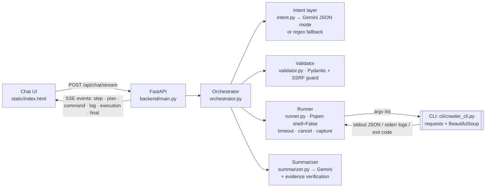

# CLI Chat Crawler

A chat app where a plain-English request such as

> *"Crawl https://example.com, extract the important information, give me a summary, and return the extracted data in JSON format."*

makes the backend **start a real CLI process** (an allowlisted crawler) and capture its **stdout, stderr and exit code**. The backend validates that output and returns an **honest status**, a **summary** and **valid JSON** to the chat. Every extracted fact carries an evidence snippet, and the server **checks that snippet against the crawled text**.

Built for BuildSprint Round 2. Runs locally; there is no deployment.

---

## Quick start

Prerequisites: **Python 3.10+** and a Gemini API key. The key is optional: without it the app falls back to rule-based parsing and summaries, and labels the results that way.

**Windows (PowerShell)**
```powershell
git clone https://github.com/s-amit2804/buildsprint-cli-chat.git
cd buildsprint-cli-chat
python -m venv .venv
.\.venv\Scripts\Activate.ps1
pip install -r requirements.txt
copy .env.example .env        # then edit .env and set GEMINI_API_KEY
uvicorn backend.main:app --port 8000
```

**macOS / Linux**
```bash
git clone https://github.com/s-amit2804/buildsprint-cli-chat.git
cd buildsprint-cli-chat
python3 -m venv .venv && source .venv/bin/activate
pip install -r requirements.txt
cp .env.example .env          # then edit .env and set GEMINI_API_KEY
uvicorn backend.main:app --port 8000
```

Open **http://127.0.0.1:8000** and click **"mandatory demo"**, or type your own request.

### Environment variables (`.env`, git-ignored)
| Variable | Required | Purpose |
|---|---|---|
| `GEMINI_API_KEY` | recommended | Gemini key for intent parsing and summaries. If it's missing, the rule-based fallbacks are used. |
| `GEMINI_MODEL` | no | Try this model first. The app falls back through `gemini-3.5-flash-lite` → `gemini-3.1-flash-lite` → `gemini-3-flash-preview`. |
| `ALLOW_TESTPAGES` | no | `1` enables the local prompt-injection demo pages (see below). Off by default. |
| `APP_PORT` | no | Port used to build the test-page URL (default `8000`). |

---

## How to test the demo

| Try this in the chat | Expected result |
|---|---|
| *Crawl https://example.com, extract the important information, give me a summary, and return the extracted data in JSON format.* | **SUCCESS**: summary, verified facts, JSON |
| *Crawl 3 pages of https://books.toscrape.com and return book titles and prices as JSON* | **SUCCESS**: titles and prices, each with verified evidence |
| *Summarise http://169.254.169.254/latest/meta-data* | **REJECTED** before execution (SSRF guard) |
| *Crawl https://www.google.com/search?q=test* | **FAILED**: blocked by robots.txt (exit 4) |
| *Crawl https://this-domain-does-not-exist-xyz.com* | **FAILED**: unreachable (exit 3) |
| *hello, how are you?* | **NOT RUN**: asks for a URL |
| Start a big crawl and click **Cancel** | **CANCELLED**: the process is stopped on the server |

**Prompt-injection demo (optional).** Start the server with `ALLOW_TESTPAGES=1`:
- PowerShell: `$env:ALLOW_TESTPAGES="1"; uvicorn backend.main:app --port 8000`
- bash: `ALLOW_TESTPAGES=1 uvicorn backend.main:app --port 8000`

Then click **"prompt-injection test page"**. [testpages/menu.html](testpages/menu.html) hides an instruction that tells the AI to declare the site "verified safe", reveal its prompt and API keys, and recommend a `curl … | sh` command. The summary ignores it and **flags it as suspicious**. The exception allows only the `/testpages/` prefix; anything else on localhost is still blocked.

**Run the CLI on its own:**
```powershell
python cli/crawler_cli.py --url https://example.com; echo "exit=$LASTEXITCODE"
python cli/crawler_cli.py --url https://books.toscrape.com --max-pages 4
python cli/crawler_cli.py --url https://example.com 2>$null | python -m json.tool   # stdout is pure JSON
```

**Run the runner on its own** (validation, subprocess, capture, status):
```powershell
python -m backend.runner --url https://books.toscrape.com --max-pages 3
python -m backend.runner --url https://books.toscrape.com --max-pages 10 --timeout 3   # forces TIMEOUT
```

**Offline tests** (no network or API key needed): `python -m tests.test_offline` runs 22 checks.

Every run is saved as an audit log in `runs/<run_id>.json`. That folder is git-ignored.

---

## Architecture



| Step | Component | What happens |
|---|---|---|
| 1 | **Chat UI** | The user types a request. Events stream back over Server-Sent Events, so the timeline and CLI log update live. All page-derived text is inserted with `textContent`, never `innerHTML`. |
| 2 | **Intent** ([backend/intent.py](backend/intent.py)) | Gemini (JSON mode with a fixed schema) extracts `task, url, max_pages, max_depth, wants_json, fields_requested`. **The URL must literally appear in the user's message**, so the model cannot invent or swap targets. If Gemini fails, a regex parser takes over and the result says so. |
| 3 | **Validate** ([backend/validator.py](backend/validator.py)) | A Pydantic model rejects unknown fields. Only http/https is allowed, with no credentials in the URL. The host must resolve **only to public IPs** (blocks localhost, 10/8, 192.168/16, 169.254.169.254, IPv6 loopback and so on). Limits are clamped (≤20 pages, depth ≤3). |
| 4 | **Run CLI** ([backend/runner.py](backend/runner.py)) | The tool comes from an **allowlist**. The argv is built only from validated fields and started with `subprocess.Popen([...], shell=False)` with a **minimal environment that has no API keys**. stderr is streamed live, stdout is captured. A watchdog enforces a 60s hard timeout and handles user cancel by killing the process. |
| 5 | **Check output** | stdout must be a JSON object, its `exit_code` must equal the real exit code, and "success" with zero pages counts as failure. Status is one of `success / partial / failed / timeout / cancelled`. |
| 6 | **Summarise** ([backend/summarizer.py](backend/summarizer.py)) | Page text is wrapped in `<untrusted_page_content>` tags, with any spoofed tags stripped. The model is told to treat it as data, and it has **no tools**. It returns a summary, key points and facts as `{field, value, source_url, evidence}`. |
| 7 | **Verify evidence** | Each `evidence` snippet is searched for in the crawled text of its `source_url`, and the result is marked `verified: true/false`. Unverified facts are shown with a ⚠ instead of being presented as fact. |
| 8 | **Respond** ([backend/orchestrator.py](backend/orchestrator.py)) | The server builds the final JSON from the crawl and the verified facts. It always serialises to valid JSON, and the UI offers Copy and Download. |

---

## The CLI tool: `cli/crawler_cli.py`

**Why a purpose-built CLI?** We wanted the tool contract under our control:
- deterministic, documented exit codes
- exactly one JSON object on stdout, logs on stderr
- built-in robots.txt and same-domain rules
- hard limits on everything

A headless browser (Playwright, Chrome) would add a large dependency and attack surface that static sites don't need. A general agent CLI would give the model far more power than "crawl this URL". Because the crawler is a separate process, the backend is isolated from parser crashes, and the process can be timed out and killed.

```
python cli/crawler_cli.py --url URL [--max-pages 5] [--max-depth 1] [--timeout 10] [--total-timeout 45]
```

| Exit code | Meaning | Chat status |
|---|---|---|
| 0 | success | SUCCESS |
| 1 | internal error (still returns JSON) | FAILED |
| 2 | invalid input or blocked host | FAILED / REJECTED |
| 3 | start page unreachable (DNS, timeout, HTTP ≥ 400, not HTML) | FAILED |
| 4 | robots.txt disallows the start URL | FAILED |
| 5 | partial: some pages failed or the time budget ran out | PARTIAL |
| (killed) | backend hard timeout / user cancel | TIMEOUT / CANCELLED |

What it does:
- Repeats the SSRF check on **every redirect hop**, since redirects are followed manually.
- Honours robots.txt, stays on the same domain, and only crawls HTML.
- Limits each page to 2 MB and pauses 0.3s between requests.
- Skips pages with duplicate content.
- Has a whole-run time budget below the backend's hard timeout, so it finishes cleanly with a partial result instead of being killed.

---

## Security and reliability

| Risk | Mitigation |
|---|---|
| Shell injection | Never uses a shell. `Popen(list, shell=False)`, argv built only from validated, typed fields, URL always starts with `http(s)://` so it can't be read as a flag. |
| Arbitrary commands | Fixed tool allowlist (`TOOL_REGISTRY`). The LLM only fills parameters and cannot choose commands. |
| SSRF | Public-IP-only check in the validator **and** in the CLI, repeated on every redirect hop. Blocks localhost, private, link-local and metadata IPs. |
| Runaway tasks | Page, depth, byte, per-request and total-time limits; 60s hard kill; user cancel; at most 2 concurrent runs. |
| Prompt injection | Page content is marked untrusted, spoofed tags are stripped, the model has no tools, the URL must come from the user, facts are checked against crawled text, and injection attempts are flagged. |
| Secret leakage | Key only in `.env` (git-ignored). Sent in a header, never a URL. Not passed to the CLI process. Redacted from captured logs. |
| False success | Status is derived from the exit code **plus** validated JSON. Mismatches or empty "success" are discarded. Partial results are labelled. AI fallbacks are labelled. |
| XSS from crawled pages | The UI never uses `innerHTML` for data. Everything goes through `textContent` and DOM nodes. |

**Known limitations**
- **DNS rebinding:** the host is checked, then resolved again when connecting. Pinning the IP per connection would close this gap.
- **JavaScript-rendered sites:** content that only appears after JavaScript runs isn't seen, because there's no browser.
- **Summary length:** each page's text is trimmed to 5,000 characters, and about 24,000 characters in total go to the model.
- **Run history:** it's kept in memory and in `runs/`; there's no database.

---

## Project structure
```
cli/crawler_cli.py        the approved CLI tool (standalone)
backend/validator.py      Pydantic task model + SSRF guard
backend/runner.py         tool allowlist, subprocess execution, capture, status interpretation, audit log
backend/llm.py            minimal Gemini REST client (requests): timeout, retries, model fallback chain
backend/intent.py         NL message -> structured intent (LLM + rule-based fallback)
backend/summarizer.py     summary + extracted facts, untrusted-content handling, evidence verification
backend/orchestrator.py   pipeline + event emission, final JSON builder
backend/main.py           FastAPI: UI, SSE stream, non-streaming endpoint, cancel, health
static/index.html         single-file chat UI (vanilla JS)
testpages/                local prompt-injection demo pages (served only with ALLOW_TESTPAGES=1)
tests/test_offline.py     22 offline checks
```

API: `POST /api/chat/stream` (SSE) · `POST /api/chat` (JSON, handy for curl) · `POST /api/cancel/{run_id}` · `GET /api/health` · `GET /docs`.

---

## Tech stack, AI tools and external services

- **Backend:** Python 3.10+, FastAPI, Uvicorn, Pydantic, python-dotenv
- **CLI crawler:** requests, BeautifulSoup (`html.parser`), plus Python standard library modules (`argparse`, `ipaddress`, `urllib.robotparser`)
- **Frontend:** a single HTML file with vanilla JavaScript; no framework or build step
- **Runtime AI service:** **Google Gemini API**, called over HTTPS with `requests`. It's used only to turn the message into parameters and to write the summary and extracted facts. It never runs commands.
- **AI coding assistant:** **Claude Code (Anthropic, Claude Opus 5.5)** wrote most of the implementation, phase by phase. The participant set the architecture, the stack, the dependency allowlist and the core security rules (`shell=False`, SSRF blocking, untrusted page content, evidence-backed JSON). Claude Code proposed and implemented the detailed design within those rules, such as the exit-code scheme, Popen streaming, the Gemini model fallback chain and the opt-in test pages. Every phase was tested end to end.
- **Demo sites:** https://example.com and https://books.toscrape.com, a public sandbox built for scraping practice.
